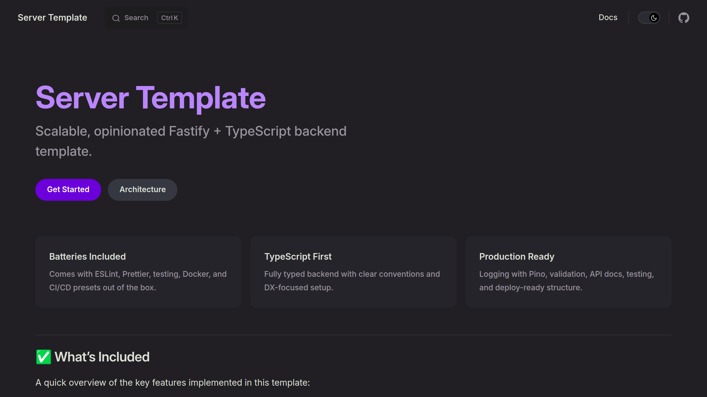
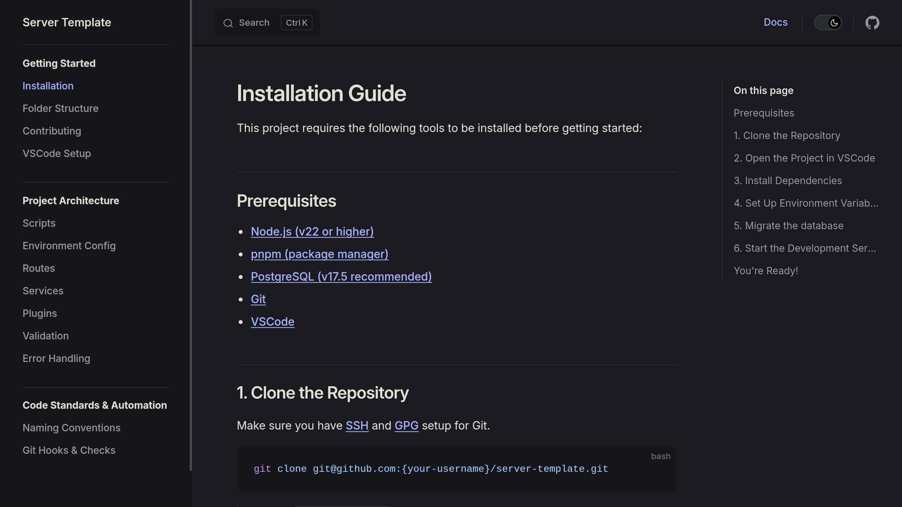
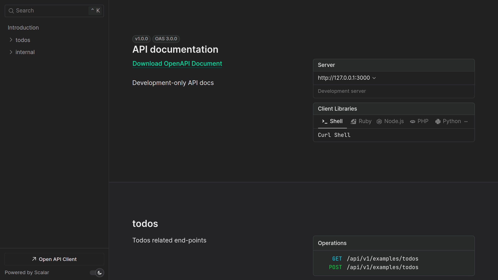
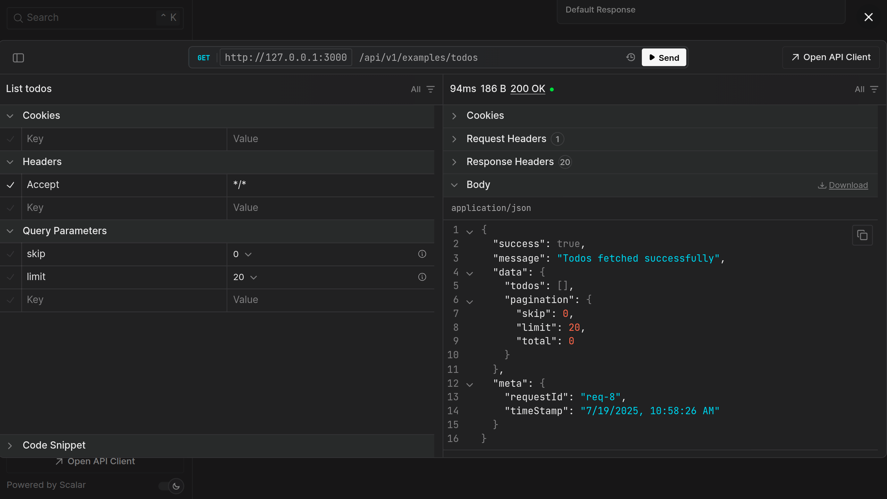

# Server Template

A scalable, opinionated Fastify + TypeScript server template with modern tooling (ESLint, Prettier, Vitest, Pino, Docker, CI/CD, API docs, and more).

## Installation

### Prerequisites

- [Node.js](https://nodejs.org/) (v22+)
- [PostgreSQL (v17.5 recommended)](https://www.postgresql.org/download/)
- [pnpm](https://pnpm.io/) (v10+)

### Quick Installation

```bash
git clone git@github.com:{your-username}/server_template.git
cd server_template
pnpm install
cp .env.example .env
pnpm db:dev
pnpm dev
```

See [Installation](./docs/getting-started/installation.md) for more details.

## How to contribute

We welcome contributions! Please follow these steps:

1. Fork the repository.
2. Create a new branch:
   ```bash
   git checkout -b feat/feature-branch-name
   ```
3. Make your changes and commit them using **Conventional Commits**:
   ```bash
   git commit -m "feat(scope): short description"
   ```
4. Push to the branch:
   ```bash
   git push origin feat/feature-branch-name
   ```
5. Create a pull request detailing your changes.

For more details on the commit format and other guidelines, please refer to the [Contributor Guidelines](./CONTRIBUTING.md).

## Documentation

To view the internal documentation:

```bash
pnpm docs:dev
```




## API documentation

Start the dev server and open [http://localhost:3000/docs](http://localhost:3000/docs).
API docs are only available for development.

```bash
pnpm dev
```




## Project status

This template is usable today, but a few pieces are still in progress:

- **Example authentication** — WIP on the `feat/auth` branch, not yet merged
- **Metrics endpoint** — planned, not yet implemented
- **Docker** — available on the `feat/docker` branch
- **Image/asset processing** and **tutorial docs** — planned

See [`TODO.md`](./TODO.md) for the full roadmap.

## License

Released under the [MIT License](./LICENSE).

Copyright (c) 2026 Lakshay Manglani.
